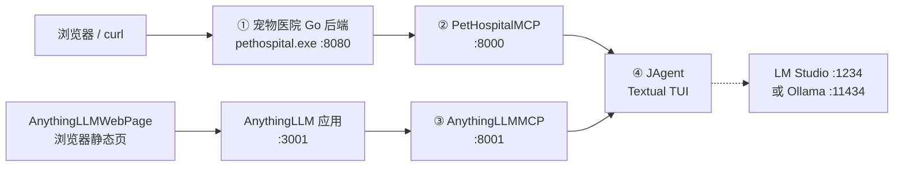

# LLM 课程项目：宠物医院 + AnythingLLM + JAgent

本仓库把两个本地服务通过 **MCP（Model Context Protocol）** 暴露给同一个 Agent：

- **宠物医院 Go REST API** → `PetHospitalMCP`
- **AnythingLLM REST API** → `AnythingLLMMCP`
- **JAgent** 通过 `.mcp.json` 同时连接两个 MCP Server，用自然语言查询宠物档案、工作区文档，并与 AnythingLLM 工作区对话

## 项目地图

| # | 模块 | 位置 | 是什么 |
| --- | --- | --- | --- |
| 1 | 宠物医院 Go 后端 | [`PetHospitalMCP/pet-hospital-windows-amd64/windows/`](PetHospitalMCP/pet-hospital-windows-amd64/windows/) | 单文件 Go 后端 `pethospital.exe`，提供网页界面与 `/api/v1/*` REST 接口，自带 `data/pet.db` 模拟数据 |
| 2 | PetHospitalMCP | [`PetHospitalMCP/pet_hospital_mcp/`](PetHospitalMCP/pet_hospital_mcp/) | Python MCP Server，把宠物医院 `GET /api/v1/pets` 暴露为 `list_pets` 工具 |
| 3 | AnythingLLMMCP | [`AnythingLLMMCP/`](AnythingLLMMCP/) | Python MCP Server，把 AnythingLLM 的工作区、文档、向量化和对话暴露为 4 个工具 |
| 4 | JAgent | [`agent/jagent/`](agent/jagent/) | 基于 Textual 的本地 Agent，连接 MCP Server 和 OpenAI 兼容模型，提供文件、网络、Skill 等工具 |

辅助目录：

- [`AnythingLLMWebPage/`](AnythingLLMWebPage/)：浏览器版文档上传工具，**直接**调用 AnythingLLM REST API，不经过 MCP。
- [`office/`](office/)：JAgent 的一个工作目录示例，包含 `.mcp.json`、`config.ini` 和 Office Skill。
- [`agent/Practice01/`](agent/Practice01/)、[`agent/Practice02/`](agent/Practice02/)：课程练习，不是本系统运行时的必需组件。
- `PetHospitalServer/`、`AnythingLLMServer/`：目前为空目录；实际后端分别由 `pethospital.exe` 和外部 AnythingLLM 应用提供。

## 模块关系图



纯文本版：

```text
[浏览器 / curl] --> (Go 后端 :8080) --> (PetHospitalMCP :8000) --\
                                                                  --> (JAgent)
[AnythingLLM :3001] -----------------> (AnythingLLMMCP :8001) --/
[AnythingLLMWebPage] ----------------> (AnythingLLM :3001)
```

谁连谁：

1. **Go 后端**不连接任何 MCP，只提供 HTTP REST。
2. **PetHospitalMCP** 通过 HTTP 调用 Go 后端，把结果包装成 MCP 工具 `list_pets`。
3. **AnythingLLMMCP** 通过 HTTP 调用 AnythingLLM REST API，提供工作区/文档/对话工具。
4. **JAgent 只连接两个 MCP Server**，不直接连接 Go 后端或 AnythingLLM；模型侧再连接 LM Studio/Ollama 等 OpenAI 兼容接口。
5. **AnythingLLMWebPage** 直接连接 AnythingLLM，不经过 MCP。

## 环境依赖总表

| 组件 | 运行时 | 版本约束 | 默认端口 | 关键依赖 / 说明 |
| --- | --- | --- | --- | --- |
| AnythingLLM（外部） | 桌面版或 Docker 单用户版 | 1.x（本仓库按桌面版接口编写） | `3001` | 必须先启动、完成模型配置、创建至少一个工作区，并生成 Developer API Key |
| ① 宠物医院 Go 后端 | Windows x64 可执行文件 | 无需 Go / 数据库运行时 | `8080` | `pethospital.exe` + `data/pet.db`，单文件即可运行 |
| ② PetHospitalMCP | Python | **3.11+**（实测 3.14.4） | `8000` | `mcp==2.0.0`、`httpx>=0.27`、`pydantic>=2.7`；必须先启动 Go 后端 |
| ③ AnythingLLMMCP | Python | **3.11+**（实测 3.14.4） | `8001` | `mcp>=2.0.0`（实测 2.2.0）；仅用标准库 `urllib`；依赖 AnythingLLM 与 API Key |
| AnythingLLMWebPage | 现代浏览器 | Chrome / Edge / Firefox | `5500`（静态服务） | 建议用 `python -m http.server` 打开，避免 `file://` 跨域 |
| ④ JAgent | Python | **3.11+**（实测 3.14.4） | 无 | `openai`、`PyYAML`、`textual`、`trafilatura`、`mcp>=2.2.0`；需要本地 `curl` |
| 可选：MCP Inspector | Node.js | 18+ | 无 | `npx @modelcontextprotocol/inspector`，用于手工验证 MCP Server |

> 两个 MCP Server 同时运行时端口必须错开。本 README 使用 `PetHospitalMCP=8000`、`AnythingLLMMCP=8001`；[`office/.mcp.json`](office/.mcp.json) 中的本地示例使用 `8090/8091`，启动时对应设置 `MCP_PORT` 即可。

## 分步启动顺序

顺序必须是：**AnythingLLM → Go 后端 → PetHospitalMCP → AnythingLLMMCP → JAgent**。MCP Server 只做协议转换，不会自动拉起后端。

### 0. 前置：启动 AnythingLLM

启动 AnythingLLM 桌面版或 Docker 实例，访问 <http://localhost:3001>，完成 onboarding、配置聊天模型，并创建一个工作区。然后生成 API Key：

**Settings（设置）→ Tools（工具）→ Developer API → Generate API Key**

```powershell
$env:ANYTHINGLLM_API_KEY = "your-anythingllm-api-key"
curl.exe -H "Authorization: Bearer $env:ANYTHINGLLM_API_KEY" http://localhost:3001/api/v1/auth
# 期望：{"authenticated":true}
```

### 1. 启动宠物医院 Go 后端

```powershell
cd D:\LLM\PetHospitalMCP\pet-hospital-windows-amd64\windows
.\pethospital.exe -addr 127.0.0.1:8080 -db data\pet.db
```

保持该窗口运行。验证：

```powershell
curl.exe http://127.0.0.1:8080/api/v1/meta
```

浏览器打开 <http://127.0.0.1:8080/> 应能看到宠物医院网页界面。详细说明见 [`README-Windows.md`](PetHospitalMCP/pet-hospital-windows-amd64/windows/README-Windows.md)。

### 2. 启动 PetHospitalMCP

```powershell
cd D:\LLM\PetHospitalMCP\pet_hospital_mcp
python -m venv .venv
.\.venv\Scripts\Activate.ps1
pip install -e ".[dev]"

$env:MCP_PORT = "8000"
$env:PET_HOSPITAL_BASE_URL = "http://127.0.0.1:8080"
python -m pet_hospital_mcp
```

验证：

```powershell
curl.exe http://127.0.0.1:8000/health
```

期望返回包含 `"status":"ok"`、`"backend":"http://127.0.0.1:8080"` 的 JSON。MCP 端点为 <http://127.0.0.1:8000/mcp>，工具为 `list_pets`。详细说明见 [`PetHospitalMCP/pet_hospital_mcp/README.md`](PetHospitalMCP/pet_hospital_mcp/README.md)。

### 3. 启动 AnythingLLMMCP

```powershell
cd D:\LLM\AnythingLLMMCP
python -m venv .venv
.\.venv\Scripts\Activate.ps1
pip install -r requirements.txt

Copy-Item .env.example .env
notepad .env      # 填入 ANYTHINGLLM_API_KEY，确认 MCP_PORT=8001
python server.py
```

如果已有 AnythingLLM 密钥，也可以不用 `.env`：

```powershell
$env:ANYTHINGLLM_API_KEY = "your-anythingllm-api-key"
$env:ANYTHINGLLM_BASE_URL = "http://localhost:3001/api"
$env:MCP_PORT = "8001"
python server.py
```

验证：

```powershell
npx @modelcontextprotocol/inspector
# Streamable HTTP URL: http://127.0.0.1:8001/mcp
```

应能看到 `first_workspace_files`、`chat_workspace`、`upload_document`、`update_workspace_embeddings` 四个工具。详细说明见 [`AnythingLLMMCP/README.md`](AnythingLLMMCP/README.md)。

可选的浏览器验证工具：

```powershell
cd D:\LLM\AnythingLLMWebPage
Copy-Item config.example.js config.js
notepad config.js      # 填入 apiKey
python -m http.server 5500
# 浏览器打开 http://localhost:5500/
```

### 4. 启动 JAgent

确认 [`agent/jagent/.mcp.json`](agent/jagent/.mcp.json) 同时包含两个本地 MCP Server：

```json
{
  "mcpServers": {
    "PetHospitalMCP": {
      "type": "streamable_http",
      "url": "http://127.0.0.1:8000/mcp"
    },
    "AnythingLLMMCP": {
      "type": "streamable_http",
      "url": "http://127.0.0.1:8001/mcp"
    }
  }
}
```

配置模型并启动：

```powershell
cd D:\LLM\agent\jagent
Copy-Item config.example.ini config.ini
notepad config.ini      # 填写 [llm] base_url / model / api_key
pip install -r requirements.txt
python main.py
```

- 本地 LM Studio：`base_url = http://127.0.0.1:1234/v1`，`api_key = DUMMY`
- 本地 Ollama：`base_url = http://127.0.0.1:11434/v1`，`api_key = DUMMY`
- 远程 OpenAI 兼容接口：填写对应地址与真实 Key（只写入本地 `config.ini`）

启动后侧边栏出现两个 MCP Server 及其工具即表示连接成功。可以尝试：

- “列出当前待就诊的宠物，按总花费从高到低排序”
- “第一个工作区里有哪些文档？”
- “根据第一个工作区的文档回答：项目的主要目标是什么？”

详细说明见 [`agent/jagent/README.md`](agent/jagent/README.md)。

> 也可以把 `office/` 作为 JAgent 的工作目录：`cd D:\LLM\office` 后运行 `python D:\LLM\agent\jagent\main.py`。此时使用 `office/config.ini` 和 [`office/.mcp.json`](office/.mcp.json)（端口为 `8090/8091`）。

## 子项目入口链接

| 子项目 | 文档 | 代码 / 可执行入口 |
| --- | --- | --- |
| 宠物医院 Go 后端 | [Windows 运行说明](PetHospitalMCP/pet-hospital-windows-amd64/windows/README-Windows.md)、[完整接口文档](PetHospitalMCP/pet-hospital-windows-amd64/windows/README.md) | [`pethospital.exe`](PetHospitalMCP/pet-hospital-windows-amd64/windows/pethospital.exe)、[`data/pet.db`](PetHospitalMCP/pet-hospital-windows-amd64/windows/data/pet.db) |
| PetHospitalMCP | [README](PetHospitalMCP/pet_hospital_mcp/README.md) | [`__main__.py`](PetHospitalMCP/pet_hospital_mcp/src/pet_hospital_mcp/__main__.py)、[`list_pets.py`](PetHospitalMCP/pet_hospital_mcp/src/pet_hospital_mcp/tools/list_pets.py)、[`pyproject.toml`](PetHospitalMCP/pet_hospital_mcp/pyproject.toml) |
| AnythingLLMMCP | [README](AnythingLLMMCP/README.md) | [`server.py`](AnythingLLMMCP/server.py)、[`.env.example`](AnythingLLMMCP/.env.example)、[`requirements.txt`](AnythingLLMMCP/requirements.txt) |
| AnythingLLMWebPage | [README](AnythingLLMWebPage/README.md) | [`index.html`](AnythingLLMWebPage/index.html)、[`config.example.js`](AnythingLLMWebPage/config.example.js) |
| JAgent | [README](agent/jagent/README.md) | [`main.py`](agent/jagent/main.py)、[`config.example.ini`](agent/jagent/config.example.ini)、[`.mcp.json`](agent/jagent/.mcp.json) |
| 课程练习 | [Practice02 README](agent/Practice02/README.md) | [`Practice01/`](agent/Practice01/)、[`Practice02/`](agent/Practice02/) |

## 安全与配置：真实密钥不入库

本仓库**受版本控制的文件不包含任何真实密钥**。以下文件只保留占位符，直接提交是安全的：

- [`agent/jagent/config.example.ini`](agent/jagent/config.example.ini)（复制为本地 `config.ini`）
- [`AnythingLLMMCP/.env.example`](AnythingLLMMCP/.env.example)（复制为本地 `.env`）
- [`AnythingLLMWebPage/config.example.js`](AnythingLLMWebPage/config.example.js)（复制为本地 `config.js`）
- [`office/config.ini`](office/config.ini) 中的 `baidu_qianfan_api_key` 保持占位符

本地真实配置已被忽略，不要强制提交：

| 文件 | 用途 | 忽略规则 |
| --- | --- | --- |
| `agent/jagent/config.ini` | JAgent 模型、搜索 API Key | `agent/jagent/.gitignore` |
| `AnythingLLMMCP/.env` | AnythingLLM API Key | `AnythingLLMMCP/.gitignore` |
| `AnythingLLMWebPage/config.js` | 浏览器上传工具的 API Key | `AnythingLLMWebPage/.gitignore` |
| `agent/jagent/history.json`、`.agents/sessions/`、`.agents/context/` | 会话历史 | `agent/jagent/.gitignore` |

如果曾经把真实密钥写进过提交，请立即到对应控制台**吊销并重新生成**：

- AnythingLLM：Settings → Tools → Developer API
- 百度千帆：百度智能云控制台 → API Key 管理
- ModelScope：ModelScope 访问令牌页面

## 常见启动问题

| 现象 | 原因 | 处理 |
| --- | --- | --- |
| PetHospitalMCP 返回 `BACKEND_UNAVAILABLE` | Go 后端未启动或端口不对 | 先执行第 1 步，确认 `curl http://127.0.0.1:8080/api/v1/meta` |
| AnythingLLMMCP 启动即报 `缺少环境变量 ANYTHINGLLM_API_KEY` | 未设置 Key | 设置环境变量或创建 `.env`；Key 在 Settings → Tools → Developer API 生成 |
| 两个 MCP Server 只有一个能启动 | 端口冲突 | 分别设置 `MCP_PORT=8000` 和 `MCP_PORT=8001` |
| JAgent 侧边栏只有本地工具 | `.mcp.json` 未包含 MCP Server、URL 错误或服务未启动 | 先用 MCP Inspector 验证 `/mcp`，再检查 `.mcp.json` |
| JAgent 无法连接模型 | LM Studio/Ollama 未启动或模型名不一致 | 检查 `[llm] base_url`、`model`；jagent 会在本机端口未监听时尝试自动拉起 |
| 搜索工具失败 | `[search] baidu_qianfan_api_key` 仍是占位符 | 在本地 `config.ini` 填入真实 Key，不要提交 |
