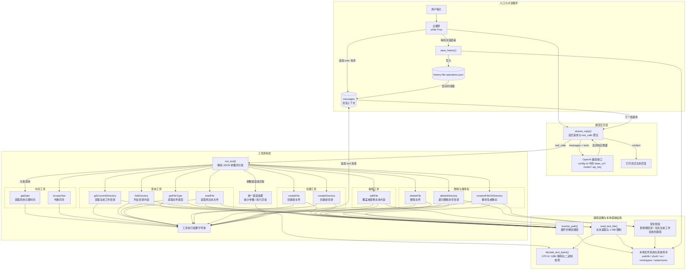

# Practice02：本地文件操作 Function Calling Agent

本项目基于 `main-stream-tool-getDate-isLeapYear.py` 扩展，在保留时间工具的基础上新增一组本地文件操作 function call。程序通过 OpenAI 兼容接口与模型交互，支持流式输出、多轮工具调用和会话历史持久化。

## 功能特性

- 流式接收模型回复，并实时打印文本内容
- 按 `index` 聚合流式返回的 `tool_calls`，支持一次返回多个工具调用
- 工具执行结果自动回填到会话，继续下一轮模型推理，直到不再调用工具
- 启动时加载历史会话，每轮对话结束后写入 `history-file-operations.json`
- 文本文件读取与编辑支持 UTF-8、GBK 编码，并拒绝二进制文件
- 删除和重命名操作包含基础安全校验，避免误删根目录或当前工作目录

## 工具清单

| 工具 | 参数 | 说明 |
| --- | --- | --- |
| `getDate` | 无 | 获取当前电脑的日期和时间 |
| `isLeapYear` | `year: integer` | 判断年份是否为闰年 |
| `getCurrentDirectory` | 无 | 获取当前工作目录的绝对路径 |
| `listDirectory` | `path?: string` | 列出目录下的文件和子目录，默认当前目录 |
| `getFileType` | `path: string` | 获取文件类型，如文本、图片、音频、视频、压缩包、文档、可执行文件等 |
| `readFile` | `path: string` | 读取纯文本文件内容，最大 1 MB |
| `createFile` | `directory: string, filename: string, content?: string` | 在指定目录创建新文件，不覆盖已有文件 |
| `editFile` | `path: string, content: string, old_content?: string` | 提供 `old_content` 时替换第一处匹配内容，否则覆盖整个文件 |
| `createDirectory` | `path: string` | 创建新目录，支持多级目录 |
| `deleteDirectory` | `path: string` | 递归删除目录及其全部内容，支持非空目录 |
| `deleteFile` | `path: string` | 删除指定文件 |
| `renameFileOrDirectory` | `old_path: string, new_path: string` | 重命名文件或目录，也可用于移动 |

## 代码架构

架构图源文件：[main-stream-tool-file-operations-architecture.mmd](main-stream-tool-file-operations-architecture.mmd)



## 目录结构

```text
agent/Practice02/
├── main-stream-tool-getDate.py                     # 基础示例：仅 getDate
├── main-stream-tool-getDate-isLeapYear.py          # 基础示例：getDate + isLeapYear
├── main-stream-tool-file-operations.py             # 本项目主程序：时间 + 文件操作工具
├── main-stream-tool-file-operations-architecture.mmd
├── README.md
├── config.ini                                      # 模型接口配置
├── .gitignore
└── history-file-operations.json                    # 运行时生成的历史记录
```

## 运行方式

```powershell
cd D:\LLM\agent\Practice02
pip install openai
python main-stream-tool-file-operations.py
```

`config.ini` 需要与脚本在同一目录下运行，配置示例：

```ini
[llm]
base_url = http://127.0.0.1:1234/v1
model = qwen3.5-4b
api_key = DUMMY
```

## 交互示例

```text
请输入提示词: 列出当前目录下的所有文件
[工具 listDirectory] 目录: D:\LLM\agent\Practice02
...

请输入提示词: 在 sub 目录下创建一个 notes.txt，内容为 hello
[工具 createFile] 已创建文件: D:\LLM\agent\Practice02\sub\notes.txt（5 字节）
...

请输入提示词: 把 sub/notes.txt 重命名为 sub/notes.md，然后删除 sub 目录
...
```

## 实现说明

### 流式工具调用

`stream_reply()` 读取模型返回的流式增量：

- `delta.content` 直接拼接并打印
- `delta.tool_calls` 按 `index` 聚合工具 ID、名称和参数字符串
- 参数可能被拆分为多个片段，因此使用字符串累加后再统一 `json.loads`

### 工具分发与错误处理

`run_tool()` 根据工具名分发到具体函数，并统一捕获以下异常：

- JSON 参数解析失败
- 缺少必填参数（`KeyError`）
- 文件不存在、权限不足、路径非法等执行异常

异常会被转换为字符串返回给模型，不会中断对话循环。

### 文本文件判定

`read_text_file()` 与 `decode_text_bytes()` 使用以下规则判断是否为可读文本：

1. 文件大小不能超过 1 MB
2. 内容不能包含空字节 `\x00`
3. 依次尝试 `UTF-8-SIG`、`UTF-8`、`GBK` 解码
4. 全部解码失败时拒绝读取

`getFileType()` 优先根据扩展名和 `mimetypes` 判断类型，无法判断时读取前 4096 字节进行文本/二进制探测。

### 安全限制

- `createFile` 使用独占创建模式（`x`），不会覆盖已有文件
- `deleteDirectory` 使用 `shutil.rmtree`，但拒绝删除文件系统根目录以及包含当前工作目录的路径
- `renameFileOrDirectory` 拒绝重命名包含当前工作目录的目录，且目标路径必须不存在
- 删除和重命名操作没有二次确认，使用时需谨慎

## 注意事项

- 本项目仅用于本地 Function Calling 学习与实践，不建议直接暴露为公网服务
- 工具具备删除文件、删除目录和移动文件的能力，请避免让模型操作重要目录
- 历史记录文件 `history-file-operations.json` 已在 `.gitignore` 中忽略
- 更换模型后，工具调用参数格式可能需要根据模型能力进行微调
